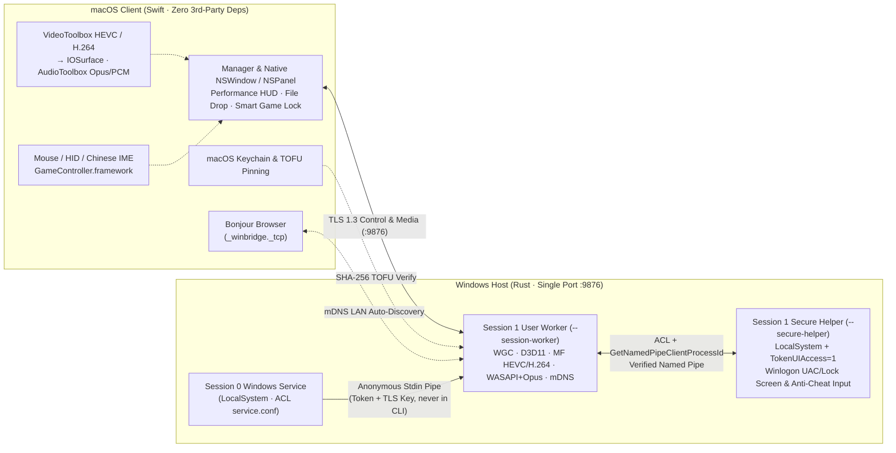

# WinBridge

[](https://github.com/WormW/winbridge/actions/workflows/ci.yml)

面向局域网（LAN）与远程隧道的**无缝单窗口远程操控工具**：将 Windows 上的单个或多个应用窗口以低延迟、端到端 TLS 1.3 加密方式投射到 macOS 上，像原生 macOS 窗口一样浏览、缩放、输入中文与键鼠/手柄操控。

> 典型场景：Windows 主机与 Mac 共用显示器，平时显示器切给 Mac 使用，无需来回切换显示器输入源即可在 Mac 上直接使用 Windows 应用、安卓模拟器（如 MuMu）或 3D PC 游戏。

---

## 系统架构



---

## 核心特性

### 1. 安全加固（Security Hardening）
- **TLS 1.3 端到端加密 + TOFU 指纹锁定**：默认使用 `rustls`（`ring`）与 macOS `Network.framework` 对控制与媒体双通道进行 TLS 1.3 加密。首次连接自动记录主机证书 SHA-256 指纹（TOFU）；若证书发生意外变化则阻断连接并弹窗警告（支持调试模式 `--no-tls`）。
- **零明文凭据暴露**：
  - Windows 服务模式将口令与配置存储在仅限 `SYSTEM` 与 `Administrators` 可读的 `C:\ProgramData\WinBridge\service.conf`（SDDL 强隔离），SCM `ImagePath` 与子进程命令行中**不再出现任何 Token 或私钥**（由 Session 0 通过匿名 `stdin` 管道传递给 Worker）。
  - macOS 客户端将 `authToken` 自动迁移并加密保存在原生 **macOS Keychain** 中。
- **权限面最小化与防爆破**：
  - `--secure-helper` 改用 **Windows Named Pipe**（禁用远端访问 `PIPE_REJECT_REMOTE_CLIENTS`、严格 SDDL DACL）并在每次连接后通过 **`GetNamedPipeClientProcessId`** 校验调用方必须是服务启动的精确 `--session-worker` PID。
  - 非回环监听默认强制要求 Token（除非显式 `--allow-insecure-no-auth`）；使用常量时间比较、按 IP 指数退避防爆破锁定，并支持 `--allow-cidr` 来源网段白名单。

### 2. 无缝多窗口、游戏操控与日常体验
- **局域网自动发现（mDNS / Bonjour）+ 指数退避自动重连**：Windows 端自动广播 `_winbridge._tcp.local.`，Mac 端下拉即可一键选择主机；意外断连或 Windows 唤醒后自动重连并恢复此前打开的窗口与桌面。
- **双采集模式（按进程记忆）**：
  - **单窗模式（`WINDOW`）**：`WGC CreateForWindow`，支持多窗口互相遮挡并行投射。
  - **屏幕裁剪模式（`MONITOR_CROP`）**：`CreateForMonitor` 裁剪窗口可见边界，完美兼容 MuMu 模拟器、Vulkan / DirectX 游戏与叠加层。
- **智能 3D 游戏鼠标锁定（`⇧⌘L` 开关 / `Ctrl+Option` 随时释放）**：
  - 自动感知 Windows 游戏指针显隐（如游戏内按住 `Alt` 或弹出菜单时自动切回限域可见指针，返回 3D 战斗视角自动切换隐藏相对视角 `dx/dy`）。
  - 支持按进程记住灵敏度倍率与自动开启游戏锁定；可选「背景禁悬停」避免多窗误触。
- **可切换性能 HUD（`⇧⌘H`）**：远端窗口右上角半透明浮层实时展示编码格式、FPS、实时码率（Mbps）、RTT 与分辨率（完全鼠标穿透）。
- **跨设备双向传文件（拖放 + 剪贴板即传）**：
  - **Mac → Windows**：把 Mac 文件拖入任意远端窗口，窗口内实时浮现拖放遮罩、进度条与完成 Toast；Windows 保存到 `Downloads\WinBridge\` 后自动写入剪贴板（`CF_HDROP`），按 `⌘V` 即可直接粘贴进桌面/资源管理器/聊天框。
  - **Windows → Mac**：在 Windows 允许目录内 `Ctrl+C` 复制文件后，≤20 MB 自动拉取并写入 Mac 剪贴板（切回 Mac 直接 `⌘V` 粘贴），大文件可按 `⌥⇧⌘V` 按需取回；也可打开菜单「从 Windows 取回文件…」，支持快捷目录（WinBridge / 桌面 / 下载 / 文档）、多选批量取回、**直接拖出列表项到 Mac 桌面 / Finder**，以及文件夹自动打包 `.zip` 传回。单文件/压缩包上限 512 MiB。
- **手柄透传（可选）**：macOS 原生 `GameController.framework`（Xbox / DualSense / Switch Pro）转发至 Windows；若本机已安装 [ViGEmBus](https://github.com/nefarius/ViGEmBus) 并将 `ViGEmClient.dll` 置于同目录，自动虚拟 Xbox 360 手柄。
- **固定本地代码签名脚本**：提供 `./scripts/setup_codesign.sh`，重新打包 `WinBridge.app` 后保持签名身份不变，彻底避免 macOS 15/26 反复重置「本地网络」与钥匙串权限。

### 3. 视频与音频编解码（4K / 高刷 / Wi-Fi 友好）
- **HEVC (H.265) + H.264 硬件低延迟管线**：Windows D3D11 GPU `BGRA → NV12` + Media Foundation 零 B 帧硬件编码（自动探测并优先协商 `HEVC → H.264 → JPEG`），macOS `VideoToolbox` 硬解 → `IOSurface` 零拷贝上屏。
- **画质档位 + 自适应码率**：菜单「画质」可选自动 / 文字（最高 30fps，把码率留给清晰度）/ 游戏（吃满主机帧率上限），并可按进程记住。开启「自适应码率」后，主机按发送队列积压和 Mac 回报的 RTT 通过 `ICodecAPI` 在线平滑调节码率（基础值的 50%–100%，不低于 800 kbps，带防抖与冷却避免重建编码器卡顿）。
- **Opus 低带宽音频 + PCM 无损双模**：基于 Windows WASAPI 环回采集 + 纯 Rust RFC 6716 **Opus 编码**（内置 48 kHz 重采样，支持 `Opus 128k` / `Opus 64k` 将带宽降至原 PCM 的 1/12 ~ 1/24）与 macOS 原生 `AudioToolbox`（`AVAudioConverter`）硬/系统解码，亦可一键切回 `PCM 无损`。菜单「只采集已投射进程」会把已订阅窗口的进程树混成一路音频（Windows 10 20348+ / Windows 11）；不支持或订阅了完整桌面时自动退回整机环回，并在 Mac 上提示。

---

## 仓库结构

```text
winbridge/
├── .github/workflows/  # CI（Windows MSVC + macOS Swift 6）与 Tag 自动发布 Release
├── protocol/           # 两端共享的协议定义（单一事实来源）
│   ├── control.proto   # 控制信道 Protobuf v3 Schema
│   └── SPEC.md         # TLS 1.3 + 单端口双信道、32B 媒体头、HEVC/Opus/输入/文件传输规范
├── win-host/           # Windows 被控端（Rust：WGC、Media Foundation HEVC/H.264、WASAPI+Opus、rustls、mDNS）
│   └── DESIGN.md       # Windows 端架构设计文档
└── mac-client/         # macOS 主控端（Swift：AppKit、VideoToolbox、AVAudioEngine/Opus、Network TLS、Keychain、GameController）
```

---

## 快速开始

### 1. Windows 被控端（`win-host`）

**环境要求**：Windows 10（1903+）或 Windows 11（x64），已安装 Rust stable MSVC 工具链与 Visual C++ 生成工具（无需手动安装 `protoc` 或 CMake）。

```powershell
cd win-host
cargo test --locked
cargo build --release --locked

# 推荐：以管理员 PowerShell 安装为系统服务（自动生成强随机 Token 并写入受保护的 service.conf，支持 UAC & 锁屏点击）
.\target\release\win-host.exe --install-service --bind 0.0.0.0 --port 9876

# 或显式指定自定义 Token 与允许的来源网段
.\target\release\win-host.exe --install-service --bind 0.0.0.0 --port 9876 --token "your-LAN-secret" --allow-cidr 192.168.1.0/24

# 前台直接运行（开发/单次调试；亦可通过环境变量 WINBRIDGE_TOKEN 或 --token-file 传入口令）
$env:WINBRIDGE_TOKEN = "your-LAN-secret"
.\target\release\win-host.exe --bind 0.0.0.0 --port 9876

# 停止并卸载系统服务
.\target\release\win-host.exe --uninstall-service
```

常用启动参数：
- `--bind <ADDR>` / `--port <PORT>`：监听地址与单端口（默认 `0.0.0.0:9876`）。
- `--token <SECRET>` / `--token-file <PATH>` / 环境变量 `WINBRIDGE_TOKEN`：预共享鉴权口令（非回环监听默认必填；仅受控测试可用 `--allow-insecure-no-auth`）。
- `--allow-cidr <CIDR>`：可重复指定的来源 IP/CIDR 白名单（如 `192.168.1.0/24`、`100.64.0.0/10`）。
- `--no-tls` / `--tls-dir <DIR>`：禁用 TLS（仅调试）或指定自定义 TLS 证书目录。
- `--no-discovery`：禁用局域网 mDNS 广播。
- `--codec <auto|hevc|h264|jpeg|raw>`：编码器策略（默认 `auto`，优先硬件 HEVC → H.264 → JPEG）。
- `--capture-mode <window|monitor-crop>` / `--fps <FPS>` / `--bitrate <KBPS>`：默认采集模式、帧率上限（默认 `60`）与视频码率（默认 `15000` kbps）。

### 2. macOS 主控端（`mac-client`）

**环境要求**：macOS 14+，Swift 6.0+（仅需 Apple Command Line Tools，无需安装 Xcode.app，零第三方依赖）。

```bash
cd mac-client
./scripts/run_tests.sh

# 可选（强烈推荐，仅需执行一次）：创建本地固定自签证书，防止重打包后 macOS 重置本地网络权限
./scripts/setup_codesign.sh

./scripts/bundle_app.sh
open build/WinBridge.app
```

**快捷使用指南**：
1. 打开 `WinBridge.app`，从顶部 **「发现主机」** 下拉框一键选择局域网内的 Windows 主机（或手动输入 IP），粘贴 Token 点击**连接**。
2. 首次 TLS 连接会自动信任并锁定 Windows 主机 SHA-256 证书指纹（可在菜单 `窗口 → 重置当前主机 TLS 证书信任` 重置）。
3. **快捷键一览**：
   - `⇧⌘L`：开启 / 关闭智能 3D 游戏鼠标锁定（`Ctrl+Option` 随时紧急释放）
   - `⇧⌘H`：显示 / 隐藏右上角实时性能 HUD（FPS / Mbps / RTT / 分辨率）
   - `⌘,`：唤出 WinBridge 管理窗口；`点红叉 / ⌘W`：仅关闭本地查看窗口，Windows 软件继续运行；可通过窗口菜单“重新显示本地已关闭窗口”恢复
   - 拖放 Mac 文件到任意远端窗口：自动发送至 Windows `Downloads\WinBridge\`

---

## 调试与测试

```powershell
# Windows 桌面集成测试（双窗口、Resize、弹窗、光标、GPU NV12、H.264 关键帧）
cd win-host
cargo test --locked -- --ignored --test-threads=1
```

---

## 相关文档

- 协议 Schema：[protocol/control.proto](protocol/control.proto)
- 协议规范（TLS / 帧格式 / HEVC / Opus / 文件传输 / 手柄）：[protocol/SPEC.md](protocol/SPEC.md)
- Windows 端开发设计文档：[win-host/DESIGN.md](win-host/DESIGN.md)


## Fork: QQ / WeChat image windows and transparent cards

此分支补充普通顶层图片查看器、隐藏 owner 链和同安装目录辅助进程的自动追踪。
两端更新后启用 **追踪弹窗**，先投射 QQ／微信，再打开图片。图片查看器以可聚焦、
带标题栏的 Mac 窗口显示；资料卡与菜单通过逐帧透明遮罩保留透明边缘，黑色图片不会被抠掉。
透明处理需要“单窗”采集；屏幕裁剪只得到桌面合成结果。已有窗口或归属不明确的窗口仍需手动投射。

This fork follows newly opened image/application windows and verified same-installation
helper processes, and preserves per-frame transparency for followed cards and menus.
Update **both** host and client, enable **Follow popups**, project the chat window, then
open an image. Existing or ambiguously associated windows still require manual selection.
See [protocol and performance limits](protocol/SPEC.md#followed-application-windows-and-alpha-fork-extension).

[Test coverage / 测试范围](docs/popup-alpha-validation.md).

### Window management / 窗口管理

This fork follows Kokoda's separation of application membership and window roles.
Independent viewers remain normal Mac windows. Owned floating/modal windows are
focusable panels excluded from the Window menu; menus/tooltips stay borderless.
The red close button and Cmd+W hide the local viewer and its owned subtree, never
send a remote close. Independent siblings remain visible. Restore from the Window
menu or the manager's **重新显示** button. **结束投射** ends the subscription;
the application's own buttons inside the streamed picture still act on Windows.

本分支参考 Kokoda 的窗口角色与本地关闭语义：独立图片窗口单独管理；所属浮窗／模态
对话框使用可聚焦原生面板，不加入窗口菜单；菜单、提示保留无边框。Mac 红色关闭按钮
和 ⌘W 只隐藏本地窗口及所属子树，独立窗口继续显示。可从窗口菜单或管理列表恢复；
“结束投射”才释放订阅。远端画面内应用自己的关闭按钮仍操作 Windows。

Local close/minimize/zoom never change the host window. Hiding a modal viewer does
not dismiss the Windows dialog or unblock its parent. Hidden viewers currently
continue receiving/decoding frames, and local hiding resets on disconnect; bandwidth
pausing and reconnect persistence are not implemented in this fork yet.

本地关闭／最小化／最大化不改变主机窗口。隐藏模态查看窗口不会解除主机父窗口阻断，
需恢复对话框继续操作。当前隐藏窗口仍接收／解码，断开连接后清除隐藏状态；暂停传输
及重连保留隐藏状态尚未移植。
