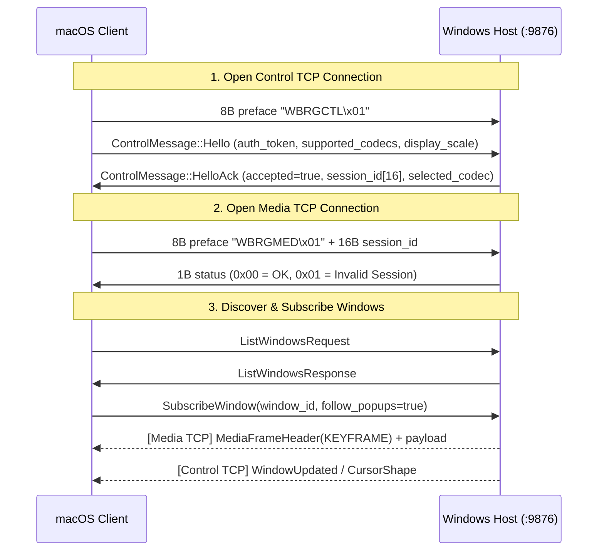

# WinBridge Protocol Specification (v0.2)

WinBridge is a LAN-first seamless remote window protocol allowing a **macOS Client** (Swift) to display and control individual windows hosted on a **Windows Host** (Rust).

Design influences:
- **Xpra**: Normal vs. Override-Redirect (`POPUP`) window model and cursor shape sync.
- **Microsoft `[MS-RDPERP]` (RAIL)**: Visible frame bounds (`DWMWA_EXTENDED_FRAME_BOUNDS`), owner/modal relationships, and sequence-numbered resize anti-looping.
- **RustDesk / Sunshine**: Low-latency HEVC/H.264 Annex-B streaming, Opus audio, TLS TOFU pinning, and clean input abstraction.

---

## 1. Transport Layer (Single Port, TLS 1.3 + Dual Channels)

Windows Host listens on a single TCP port (default: **`9876`**) so only one Windows Firewall rule is required. Both connections **MUST** set `TCP_NODELAY = true` and wrap the TCP stream in **TLS 1.3** (with TLS 1.2 minimum fallback; `--no-tls` opt-out for local debugging only). Clients authenticate the host certificate via **TOFU (Trust On First Use)** SHA-256 certificate fingerprint pinning per `host:port`, and pin the Media connection to the exact leaf certificate verified on the Control connection.

LAN discovery uses mDNS / Bonjour service type **`_winbridge._tcp.local.`** with TXT keys `v=1`, `tls=1|0`, and `fp=<8-byte hex prefix>`.

Every incoming TCP connection starts with an **8-byte ASCII+version preface** so the host can route it:

| Channel | Direction | 8-Byte Preface (Hex) | Purpose |
| :--- | :--- | :--- | :--- |
| **Control** | Bidirectional | `WBRGCTL\x01` (`57 42 52 47 43 54 4C 01`) | Handshake, window metadata, resize, input, cursor, clipboard |
| **Media** | Win → Mac | `WBRGMED\x01` (`57 42 52 47 4D 45 44 01`) | Multiplexed raw video frames for all subscribed windows |

### Connection Handshake Flow



- If the Control TCP connection closes, the host immediately closes the bound Media TCP connection and stops all active window capture sessions for that client.
- Keepalive: Client sends `Ping` every 5 seconds; if no traffic is received for 15 seconds, either side treats the session as dead.

---

## 2. Control Channel Framing

Immediately after the `WBRGCTL\x01` preface, both sides exchange length-prefixed Protobuf messages (defined in [control.proto](control.proto)):

```text
+---------------------------+----------------------------------------+
| uint32_be payload_len (4B)| Protobuf ControlMessage (payload_len B)|
+---------------------------+----------------------------------------+
```

- Maximum allowed `payload_len`: **16 MiB** (primarily to accommodate PNG clipboard images; anything larger MUST close the connection).

---

## 3. Media Channel Binary Frame Format

After the `WBRGMED\x01` + 16-byte `session_id` handshake returns `0x00`, Windows continuously writes frames with a **fixed 32-byte Big-Endian header** followed immediately by `payload_len` bytes of raw codec data:

| Offset | Size | Type | Field | Description |
| :--- | :--- | :--- | :--- | :--- |
| `0` | 4 | `u32` | `magic` | Fixed `0x57424D46` (`"WBMF"`) |
| `4` | 8 | `u64` | `window_id` | Windows `HWND` cast to `u64` |
| `12` | 8 | `u64` | `timestamp_us` | Host monotonic capture timestamp (microseconds) |
| `20` | 2 | `u16` | `width` | Frame width in physical pixels (for audio codecs `10`/`11`: sample rate in Hz, e.g. `48000`) |
| `22` | 2 | `u16` | `height` | Frame height in physical pixels (for audio codecs `10`/`11`: channel count, e.g. `2`) |
| `24` | 1 | `u8` | `codec` | `1`=H264, `2`=HEVC, `3`=JPEG, `4`=RAW_BGRA, `10`=AUDIO_PCM_S16LE, `11`=AUDIO_OPUS |
| `25` | 1 | `u8` | `flags` | Bitmask: `0x01`=KEYFRAME, `0x02`=CONFIG_ONLY, `0x04`=END_OF_STREAM |
| `26` | 2 | `u16` | `frame_seq` | Per-window wrapping frame counter (`0..65535`) |
| `28` | 4 | `u32` | `payload_len` | Byte length of the following payload (max **64 MiB**) |

### Codec Payload Rules
- **`H264_ANNEX_B (1)`**:
  - Encoded with **no B-frames**, low-latency profile (Baseline / Main / High).
  - Every frame with `KEYFRAME (0x01)` **MUST** inline `SPS` + `PPS` NAL units (with 4-byte Annex-B start codes `00 00 00 01`) before the `IDR` slice. This lets macOS `VideoToolbox` initialize or reconfigure its decoder cleanly on window open, resize, or `RequestKeyFrame`.
- **`HEVC_ANNEX_B (2)`**:
  - Same rule: inline `VPS` + `SPS` + `PPS` before every IDR frame.
- **`JPEG (3)` / `RAW_BGRA (4)`**:
  - Intended for **Day-1 MVP bring-up** before hardware encoding is wired up. Every frame sets `KEYFRAME (0x01)`. `RAW_BGRA` is tightly packed `width * height * 4` bytes (no row stride padding).

### Backpressure Policy (LAN)
- If a window's outbound media queue backs up (e.g. client decoding slower than 60 fps), **Windows Host drops intermediate non-keyframe frames** (or skips capturing new frames) rather than buffering infinitely and accumulating latency.

---

## 4. Coordinate System, Borders & DPI Contract

1. **Visible Window Bounds (Avoid the 7px Invisible Border Trap)**
   - On Windows 10/11, `GetWindowRect` includes invisible ~7px drop-shadow resize borders on left, right, and bottom.
   - Windows Host **MUST** compute `(x, y, width, height)` using `DwmGetWindowAttribute(hwnd, DWMWA_EXTENDED_FRAME_BOUNDS)` and crop WGC frames (if needed) to match these exact visible bounds.
   - `SubscribeWindow.capture_mode` selects between `CAPTURE_MODE_WINDOW` (`CreateForWindow`, supports overlapped windows) and `CAPTURE_MODE_MONITOR_CROP` (`CreateForMonitor` cropped to the target window's visible rect — required for cross-process Android emulators like MuMu, Vulkan surfaces, and hardware overlays).
   - **Full Desktop Fallback**: Subscribing to the reserved synthetic `window_id = 0xFFFF_FFFF_FFFF_0001` streams the entire primary Windows monitor (taskbar, system tray, and all windows) with full mouse/keyboard/IME input.
2. **Coordinate Mapping for Mouse Events**
   - macOS sends normalized window-local coordinates `(norm_x, norm_y)` where `(0.0, 0.0)` is the top-left of the rendered window frame and `(1.0, 1.0)` is the bottom-right.
   - Windows converts this to virtual desktop coordinates using the target window's current visible rect:
     ```text
     abs_x = rect.left + round(norm_x * rect.width)
     abs_y = rect.top  + round(norm_y * rect.height)
     ```
   - Values slightly outside `[0.0, 1.0]` are permitted during active click-and-drag gestures (e.g. text selection or resizing internal split panes).
3. **Retina / DPI Scaling**
   - `WindowInfo.width` / `height` and `MediaFrameHeader.width` / `height` are always in **Windows physical pixels**.
   - macOS computes its local `NSWindow` content size in points as:
     ```text
     mac_points_w = window.width  / (window.dpi / 96.0)   // or / display_scale if Windows runs at 200% DPI
     ```
   - Best visual sharpness on a Retina Mac: set Windows display scaling to **200% (`dpi = 192`)** so 1 Windows physical pixel maps 1:1 to 1 macOS Retina pixel!

---

## 5. Window Lifecycle, Popups & Anti-Loop Resize

1. **Popup / Menu Tracking (`follow_popups = true`)**
   - Windows Host installs `SetWinEventHook` (`EVENT_OBJECT_CREATE`, `SHOW`, `HIDE`, `DESTROY`, `LOCATIONCHANGE`, `NAMECHANGE`).
   - When a tracked process spawns an owned dialog (`WINDOW_KIND_DIALOG`) or transient popup (`WINDOW_KIND_POPUP`: e.g. `WS_POPUP`, `WS_EX_TOOLWINDOW`, menu class `#32768`, dropdowns, tooltips), the host:
     1. Sends `WindowUpdated` with `owner_window_id`, `offset_x`, and `offset_y`.
     2. Immediately starts streaming frames for that popup's `window_id` on the Media channel.
   - macOS renders `WINDOW_KIND_POPUP` as a borderless, non-activating child window positioned at `(owner_mac_origin + scaled_offset)` above the parent window.
2. **Preventing Resize Feedback Loops**
   - macOS debounces live window drag resizing (e.g. every 30–50ms or on resize end) and sends `ResizeWindow(window_id, w, h, resize_seq)`.
   - Windows calls `SetWindowPos` and echoes `ack_resize_seq` in `WindowUpdated`.
   - While macOS is actively dragging a window edge, it ignores incoming `WindowUpdated` geometry changes whose `ack_resize_seq < local_latest_resize_seq`.
3. **Preventing WGC Minimize Freeze**
   - Minimizing an `HWND` on Windows causes WGC to stop producing frames.
   - When the user minimizes a remote window on macOS, macOS only hides/minimizes its own `NSWindow` and sends `UnsubscribeWindow` (or pauses streaming) without minimizing the actual Windows `HWND`.

---

## 6. Input & Chinese IME Rules

1. **Keyboard (`KeyEvent`)**
   - macOS translates `NSEvent.keyCode` → **USB HID Usage Page `0x07`** code.
   - Windows translates USB HID Usage → PS/2 Set-1 ScanCode (with `KEYEVENTF_EXTENDEDKEY` where needed) and injects via `SendInput(KEYEVENTF_SCANCODE)`.
   - Optional macOS-side convenience mapping (configurable in UI): `Cmd + C/V/X/Z/A/F/S/W` → `Ctrl + C/V/X/Z/A/F/S` / `Alt + F4`.
2. **Chinese / CJK IME (`TextInput`)**
   - Do **not** rely on switching Windows IME remotely.
   - The macOS window implements `NSTextInputClient`; when the user commits composed text (e.g. Chinese characters), macOS sends `TextInput { window_id, text }`.
   - Windows encodes `text` to UTF-16 and injects each code unit with `SendInput` + `KEYEVENTF_UNICODE` (paired keydown + keyup).
3. **Focus Before Input**
   - On `MOUSE_EVENT_KIND_BUTTON_DOWN`, `KeyEvent`, or `TextInput`, if the target `window_id` (or its owner for popups) is not the Windows foreground window, Windows brings it to the foreground first before calling `SendInput`.
4. **High-Precision Trackpad Scroll**
   - macOS converts `NSEvent.scrollingDeltaY` / `scrollingDeltaX` (respecting natural scroll direction) into Windows `WHEEL_DELTA` units (`120.0 = 1 notch`). Windows injects fractional deltas directly via `MOUSEEVENTF_WHEEL` / `MOUSEEVENTF_HWHEEL` (supported natively since Windows Precision Touchpad / modern Win10+ apps).

---

## 7. v0.2 Additions & Future Evolution
- **Implemented in v0.2**:
  - **TLS 1.3 + TOFU pinning**, per-IP auth rate limiting, optional `--allow-cidr`, Named Pipe + `GetNamedPipeClientProcessId` secure-helper IPC, and macOS Keychain storage.
  - **mDNS / Bonjour** LAN auto-discovery (`_winbridge._tcp.local.`), exponential-backoff auto-reconnect with window restoration.
  - **HEVC (`VIDEO_CODEC_HEVC_ANNEX_B = 2`)** hardware encode/decode and **Opus (`AUDIO_CODEC_OPUS = 11`)** 48 kHz stereo 20 ms low-bandwidth audio alongside PCM lossless (`10`).
  - **Smart 3D Game Relative Mouse Lock** (`MOUSE_EVENT_KIND_RELATIVE_MOVE = 5`), **Gamepad passthrough** (`GamepadState`), and **chunked Drag-and-Drop File Transfer** (`FileTransferStart` / `FileTransferChunk` / `FileTransferResult`).
  - **Monitor list and virtual-display mode** (`ListMonitors` fields 28/29, `SetVirtualDisplay` field 46). Extra monitors use synthetic ids `0xFFFFFFFFFFFF0100+index`; `0xFFFFFFFFFFFF0001` stays the primary desktop. Setting a mode only calls `ChangeDisplaySettingsEx` on an adapter whose name already contains Virtual / Indirect / Idd / usbmmid / Parsec. No driver is bundled; if none is installed the host returns `DISPLAY_DISCONNECTED`.
- **Future (v0.3+)**:
  - Optional **QUIC** transport (`quinn` + `NWProtocolQUIC`) for per-window stream multiplexing without head-of-line blocking on lossy Wi-Fi / WAN links.
  - Per-process WASAPI audio loopback (`ActivateAudioInterfaceAsync` on Win10 20348+ / Win11).
